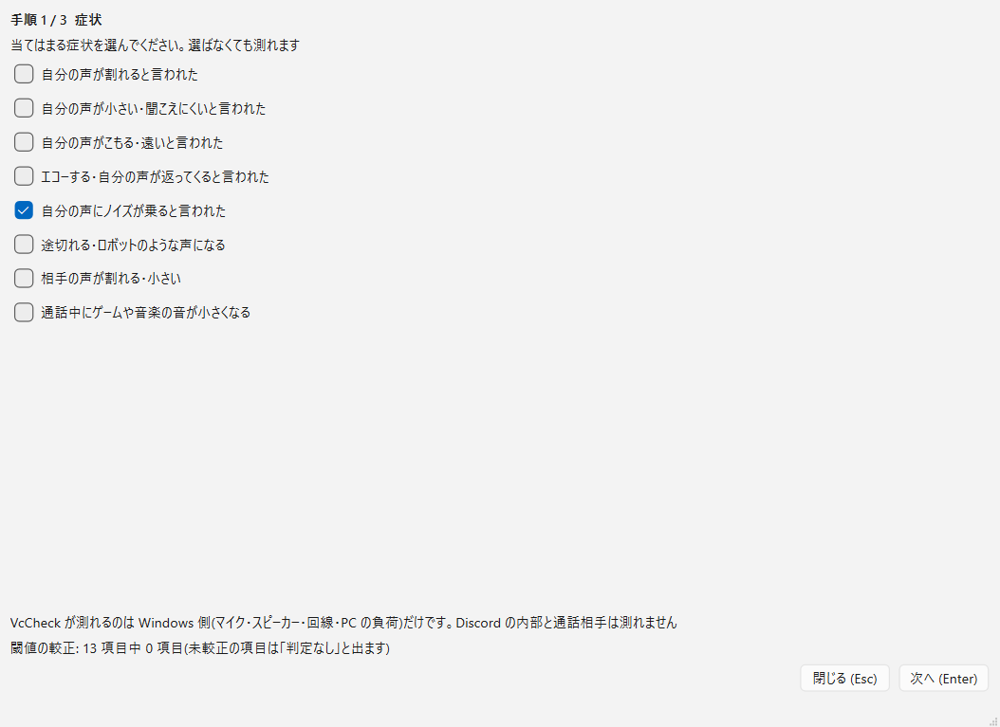
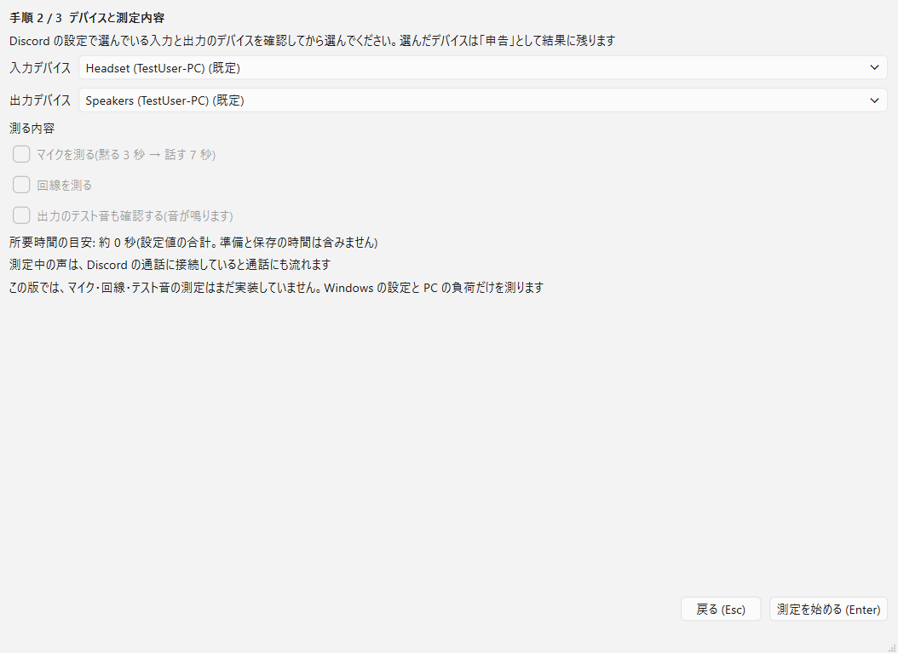
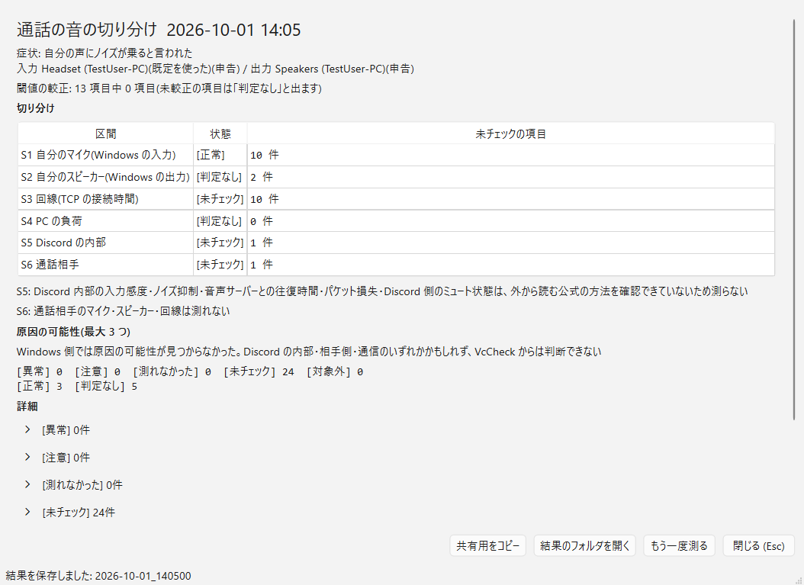

# Discord(VcCheck)

Discord の通話(VC)で「音が割れる・小さい・こもる・エコーする・ノイズが乗る・途切れる」と言われたときに、原因が自分のマイク・自分のスピーカー・回線・PC の負荷のどこにありそうかを、Windows 側から測れる範囲で切り分けるための Windows 用ツールです。

> **開発の途中です。測定の大半はまだ実装していません。**
> この版(0.2.0)が実際に測るのは、Windows の設定の読み取り(マイクの許可・通信時の音量調整)、Discord の起動の有無、PC の CPU・メモリの負荷だけです。マイクの録音、回線の測定、テスト音は未実装です。この版で画面(GUI)と exe のビルドが付きましたが、測れる内容は CLI と同じです。判定の閾値もすべて未較正(null)なので、数値の項目は必ず「判定なし」になります。くわしくは「開発状況」を見てください。

## GUI

症状 → デバイスと測定内容 → 測定 → 結果、の順に進むウィザード形式の画面です。CLI の `run` と同じ処理を呼び、その結果を表示します。色は使わず、状態は `[異常]` `[未チェック]` のような文字の印で示します。







画像は3枚とも、合成のデバイス名(`Headset (TestUser-PC)` など)とテスト用の合成データから `tools/make_screenshots.py` で作ったもので、実機の測定結果ではありません。3枚目(結果)は、この版を実際に動かしたときと同じ形にしてあります。Windows の設定と PC の負荷だけに合成の値が入り、マイク・回線・テスト音の項目はすべて「未チェック」です。

### GUI の起動

```
pip install PySide6-Essentials PySide6-Addons
python -m vccheck gui
```

または、自分でビルドした `VcCheck.exe` を引数なしで起動します(「exe を作る」を見てください)。

- デバイスの一覧に使う QtMultimedia は `PySide6-Addons` に入っています。`PySide6-Essentials` だけだと、「QtMultimedia を読み込めないため、測定を始められません」の画面で止まります
- PySide6 が入っていない環境では、`python -m vccheck gui` は案内を出して終了コード 2 で終わります。CLI のほかの機能は、PySide6 が無くても動きます

### GUI について、いま分かっていること

- **マイク・回線・テスト音の測定は、まだ実装していません。** そのため、2枚目の画面の3つのチェック(マイクを測る・回線を測る・出力のテスト音も確認する)は、オフのまま押せなくしてあります。画面から測れるのは、Windows の設定と PC の負荷だけです
- **判定の閾値は未較正です。** ほとんどの項目は「判定なし」と出ます。判定が付くのは、マイクの許可(Allow / Deny)だけです
- **実機での確認(画面設計書の段階 6d)は、まだ行っていません。** 自動テストは、合成データと、測定部を差し替えたスタブで確かめただけです
- 選んだ入力・出力のデバイスは、名前が「申告」として結果に残るだけです。そのデバイスで録音や再生はしません。デバイスの形式も読みません
- 「所要時間の目安」は、この版では「約 0 秒」と出ます。目安の式がマイク・回線・テスト音の時間だけを数えるためで、実際には PC の負荷を測るのに約 10 秒かかります(その間、画面には「測定を準備しています」と出ます)
- 「次に見る場所」は、文がまだ無いので「—」と出ます
- 入力デバイスが1台も無い PC では、「入力デバイスが見つかりません」の画面で止まり、測定を始められません

## 何のソフトか

通話の音の不具合は、どこが悪いのかの当たりを付ける作業が毎回手作業になります。VcCheck は、Windows 側から測れる範囲を1回の操作で測り、「どの区間は問題が見つからず、どの区間は怪しく、どの区間は見えないか」を1枚にまとめることを目指しています。

設計の方針は3つです。

1. **原因を断定しない。** 区間(S1 自分のマイク / S2 自分のスピーカー / S3 回線 / S4 PC の負荷 / S5 Discord の内部 / S6 通話相手)ごとに状態を出します。S5 と S6 は外から測れないので、常に「未チェック」です。原因は最大3つの「可能性」として添えるだけです。
2. **検証していない閾値を埋め込まない。** 判定の閾値は空(null)のまま置いてあり、自分の環境で較正して決めるまでは「判定なし」になります。一般論の推奨値は入れていません。
3. **測れなかったものを、測れたことにしない。** 値が取れなかった項目を 0 や既定値で埋めません。「測れなかった」「未チェック」と書きます。

## 主な機能

出力の語彙は7語(異常・注意・測れなかった・未チェック・対象外・正常・判定なし)と、確度4区分(実測・参考値・推定・申告)です。

- 区間ごとの状態表、原因の可能性(最大3つ)、全項目の表を Markdown で出す
- 結果を JSON(機械向け)・Markdown(人向け)・共有用 Markdown(デバイス名・ユーザー名・パスなどを置き換えた版)の3つに書き出す
- 結果の JSON の形を検査する(`check`)
- 複数の結果の数値項目の件数・最小・中央値・最大を出す(`stats`。閾値を決めるときの補助)
- 合成データだけで計算と出力を確かめる自己診断(`--selftest`)
- 同じ測定と結果を、ウィザード形式の画面で扱う(`gui`)

## 動作環境

- Windows 11
- Python 3.11 以上
- CLI が使うのは Python の標準ライブラリだけです(追加のインストールは不要)
- GUI には PySide6(`PySide6-Essentials` と `PySide6-Addons`)が要ります。動作を確かめたのは 6.12.0 だけです

## 使い方

リポジトリの直下で実行します。

```
python -m vccheck --selftest
python -m vccheck run --skip-mic --skip-net [--symptom <ID> ...] [--out <フォルダ>]
python -m vccheck gui
python -m vccheck report <結果.json> [--share] [--out <フォルダ>]
python -m vccheck check  <結果.json>
python -m vccheck stats  <結果.json> [<結果.json> ...]
```

- `run` は、この版では `--skip-mic` と `--skip-net` を両方付けたときだけ動きます。Windows の設定を読み、PC の負荷を約 10 秒測って、`<日時>.json`・`<日時>.md`・`<日時>.share.md` を書き出します
- `gui` は、同じ測定を画面から行います(上の「GUI」を見てください)
- `--symptom` に指定できる ID: `crackle`(自分の声が割れる)・`quiet`(小さい)・`muffled`(こもる)・`echo`(エコー)・`noise`(ノイズ)・`drop`(途切れる)・`other_side`(相手の声が割れる・小さい)・`duck`(通話中に他の音が小さくなる)。複数回指定できます
- `--out` を省くと、`config\measure.json` の `results_dir`、それが null なら `%LOCALAPPDATA%\VcCheck\results\` に保存します。GUI の保存先も同じです
- 同じ名前のファイルが既にあるときは上書きしません
- 終了コード: 0 = 正常、1 = 引数・入出力・設定ファイルのエラー(未実装の機能を呼んだときも 1)、2 = 測定を始められない(GUI で、入力デバイスが無い・QtMultimedia や PySide6 を読み込めない)、3 = `check` の違反・読めない JSON、4 = 同名の出力が既にある、5 = 使用者による中止

設定は `config\` の5つの JSON にあります。`thresholds.json`(判定の閾値。すべて null)、`measure.json`(測定の秒数など。すべて仮の値)、`rules.json`(原因の可能性の規則)、`advice.json`(次に見る場所の文。まだ空)、`net_targets.json`(回線の測定先。まだ未確定で null)。

## exe を作る

exe はリポジトリに入れておらず、配布もしていません。使うときは、自分の PC でビルドします。

```
pip install pyinstaller PySide6-Essentials PySide6-Addons
python tools/build_exe.py --smoke
```

- `dist\VcCheck.exe` ができます(1ファイル。開発機では約 29 MB、起動して画面が出るまで約 3 秒)。`--smoke` を付けると、作った exe で画面を作って閉じる確認を2回行います
- `PySide6-Addons`(QtMultimedia)が無い環境では、ビルドを止めて案内を出します
- 引数なしで起動する(ダブルクリックする)と、GUI が開きます
- 引数を付けて起動すると、CLI として動きます(例: `VcCheck.exe run --skip-mic --skip-net`)。コンソールを持たない exe なので、画面には何も出ません。終了コードは CLI と同じで、出力はファイルやパイプへ向けたときだけ受け取れます
- `config\` は exe に同梱しています。exe と同じフォルダに `config\` を置くと、そちらをフォルダごと優先して読みます(同梱の物とは混ぜません)
- 結果の保存先は CLI と同じです。`measure.json` の `results_dir` に相対パスを書いたときは、exe のあるフォルダから数えます
- 署名していない exe なので、起動するときに Windows の SmartScreen の警告が出ることがあります

## 開発状況

### 実装済み(0.2.0)

- 計算と判定の中身: 音声の集計(レベル・クリップ・DC・無音・Goertzel)、閾値による判定、区間の状態、原因の可能性の規則、Markdown と共有用 Markdown、結果の JSON の検査。**合成データでしか確かめていません**
- Windows の設定の読み取り(レジストリは読み取り専用): マイクのプライバシー許可、通信時の音量調整の設定値
- Discord の起動の有無(プロセス名の有無だけ)、PC の CPU 使用率・メモリ使用率
- CLI: `run --skip-mic --skip-net`・`report`・`check`・`stats`・`--selftest`
- GUI(`gui`): 症状・デバイスと測定内容・測定中・結果・開始できない、の5画面と3つのダイアログ。測定の中止、共有用のコピー、結果のフォルダを開く。**合成データとスタブでしか確かめていません**
- exe のビルド(`tools/build_exe.py`)

### 未実装(実物の確認待ち)

| 未実装のもの | 待っているもの |
|---|---|
| マイクの録音と測定、CLI でのデバイスの選択(`--input`・`--output`)、デバイスの形式の読み取り | 実機での録音の動作確認と、Windows のサウンド設定との突き合わせ |
| 回線の測定(TCP の接続時間)と、測定先のホスト名 | 接続先の確定と、利用規約の確認 |
| 判定の閾値(すべて null) | 実機のマイクでの較正 |
| 「次に見る場所」の文(`advice.json` は空) | Discord の設定画面の実物の確認 |
| テスト音と、スピーカーからマイクへの回り込みの測定 | 上の録音と較正の後 |
| GUI の実機での確認(画面設計書の段階 6d) | 私が実機で一通り操作して確かめること |

### 分かっている制限と、未確認のこと

- 数値の項目はすべて「判定なし」になります(閾値が未較正のため)。いま判定が付くのは、マイクの許可(Allow / Deny)だけです
- 「マイクの許可(Discord)」は、開発機では「測れなかった」になります。レジストリの Discord のエントリに、許可・拒否を表す値が無かったためです(アプリ別の値があるという前提は二次情報で、開発機の実物とは食い違いました)
- 通信時の音量調整の設定値(0〜3)の意味は二次情報に基づいていて、実機では確かめていません。値がレジストリに無い PC では「測れなかった」になります
- CPU 使用率・メモリ使用率は、タスクマネージャーの表示と突き合わせていません
- GUI の画面設計は、マイク・回線・テスト音が測れる前提で書かれています。この版では、その3つのチェックを無効にし、「この版では、マイク・回線・テスト音の測定はまだ実装していません」と画面に出しています。テスト音の2つのダイアログと、測定中の画面の残り秒の表示は、スタブでしか動かしていません
- GUI と exe を確かめたのは、開発機1台(Windows 11、PySide6 6.12.0)だけです
- 個人用のツールとして作っていて、exe の配布はしていません

## Discord には TCP の接続確立以外で触れない設計

- Discord に対して行う通信は、回線の測定(未実装)での TCP の接続確立だけにする設計です。データは送受信せず、TLS・HTTP・WebSocket・API・ログインは行いません
- **この版はネットワークに一切接続しません。** 回線の測定がまだ無いためです
- Bot の参加、クライアントの改変、Discord の設定ファイル・ログ・メモリの読み取りはしません。Discord について見るのは、プロセス名の有無と、Windows のレジストリにあるマイクの許可だけです
- 録音するのは自分のマイクだけで(未実装)、音声はメモリ内で集計して破棄し、保存しない設計です。この版の GUI が読むのは入力・出力のデバイスの名前の一覧だけで、録音も再生もしません
- Windows の設定を書き換えません。レジストリは読み取り専用で開き、音量・ミュート・既定のデバイスを変更しません
- Discord 社とは関係のない、非公式のツールです

## 開発

```
python -m ruff check .
python -m mypy
python -m pytest
python -m vccheck --selftest
```

- テストの検体は合成データだけです。実機のマイク・スピーカーを使うテストと、実機の結果は入れていません
- GUI のテスト(`tests\test_gui.py`)は、PySide6 が無い環境では飛ばします。画面を出さずに動かすため、`tests\conftest.py` が `QT_QPA_PLATFORM=offscreen` を設定します
- README の画像は `python tools/make_screenshots.py` で作り直せます(合成データだけを使います)

## ライセンス

MIT License。[LICENSE](LICENSE) を見てください。
